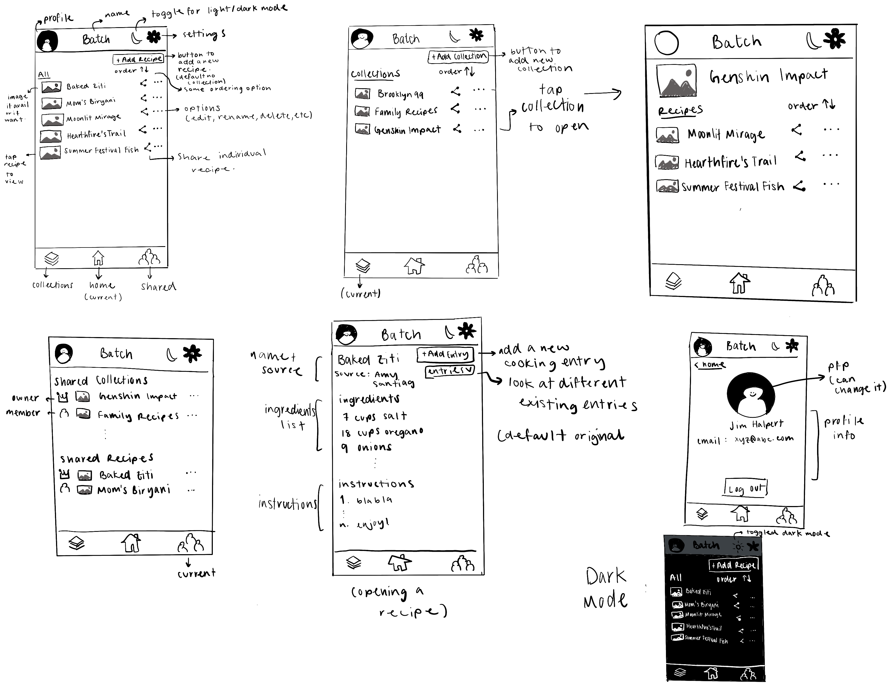

# UI Sketch

This low-fidelity sketch shows Batch's main interactions. The revised layouts retain the Home, Collections, Shared tabs from my initial sketch. I have + Add \[x\] button for adding a new recipe, entry, or collection.

## Navigation and collections

### Home

Home lists all distinct recipes the authorized user can access through owned or shared collections. Selecting a recipe opens the details on that recipe with ingredients, instructions, etc.

### Collections

This screen shows all the collections owner by the user. Creating a collection opens the name dialogue and creates the collection default to empty. The user can then add to that collection.

### Shared

This screen lists collections that are shared, whether the user is a member or the owner of the collection. The owner is marked by crown and a member is marked by the member icon.
